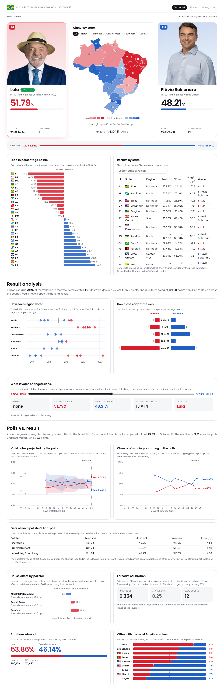

# Brazil 2026 · Presidential Runoff Dashboard

An interactive dashboard of Brazil's October 25, 2026 presidential runoff between Lula (PT) and Flávio Bolsonaro (PL): results by state, voting abroad, polls vs. result, and a set of statistical analyses built only from runoff data.



**Demo video:** [`docs/demo.mp4`](docs/demo.mp4) (about 3 minutes, subtitles only)

## What's in the dashboard

| Section | What it shows |
| --- | --- |
| Final count | Each candidate's share of valid votes, total votes, states won and the national vote margin |
| Winner by state | Choropleth map: color = winner, intensity = margin; hover for figures and state flag; region filter |
| Abroad | Result among Brazilians registered abroad, plus winner's share in nine cities |
| Lead in percentage points | States ranked from Lula's widest lead to Flávio's |
| Results by state | Sortable, searchable table of all 27 federative units |
| Result analysis | Strip plot by region with eta² (share of variance explained by region), margin histogram, uniform-swing simulator |
| Polls vs. result | Sample-weighted linear regression of the Datafolha, Quaest and AtlasIntel polls, daily chance of winning, final-poll error, house effects and Brier score |

## Headline findings

- Lula won with **51.79%** of valid votes (64,256,232) against **48.21%** (59,826,041), winning 13 states to Flávio's 13 plus the Federal District.
- Region explains about **79%** of the variation in Lula's share across states.
- Only **2 states** (Minas Gerais and Tocantins) were decided by less than 5 points.
- A uniform swing of **1.79 points** from Lula to Flávio would have flipped the national result.
- The poll trend projected Lula at about **49.5%**, so the polls underestimated him by about **2.3 points**. Every pollster's final poll was 2.6–2.8 points low.
- The daily chance-of-winning curve scored a Brier score of **0.354**, worse than always saying 50% (0.25).

## Methods

- **Poll trend.** For each day from Oct 8 to Oct 25, a weighted least-squares line is fitted to the polls released so far (weight = sample size / 2,000; polls without a published sample count as 2,000). The band is the 95% confidence interval of the fitted value, with a residual variance floor of 1 pp².
- **Chance of winning.** P(Lula > 50%) under a normal distribution whose standard deviation combines the trend's standard error and a typical 2-point polling error.
- **House effect.** Each pollster's mean residual against one regression fitted to all polls.
- **Brier score.** Mean of (probability given to Lula − 1)² over the forecast days.
- **Eta².** Between-region sum of squares divided by total sum of squares of Lula's share across the 27 states (simple, unweighted state averages).
- **Uniform swing.** The same number of points is moved from one candidate to the other in every state.

All calculations are plain JavaScript inside [`dashboard/index.html`](dashboard/index.html) (look for `dash.calc`).

## Repository layout

```
dashboard/   index.html (page, styles and charts), fonts.css (Poppins, embedded), flags.js (state and country flags)
data/        runoff datasets as JSON, plus pre-projected SVG outlines of the states
assets/      candidate photos (background removed) and the author photo used in the video
scripts/     Python helpers that built the map shapes, fonts/flags bundle and photo cut-outs
preview/     local server that runs the page with a stand-in for the dashboard runtime, and the video recorder
docs/        screenshot and demo video
```

The page was written for a Claude Artifacts dashboard, which supplies a small `dash` runtime (data loading, calculated values) and the `d3` global. `preview/server.js` provides a minimal stand-in for that runtime, so the page runs locally.

## Run it locally

```bash
npm install d3@7.9.0 --no-save
node preview/server.js          # then open http://localhost:8765
```

To record the demo video again (needs Playwright with Chromium and ffmpeg):

```bash
node preview/server.js &
node preview/record_demo.js     # writes preview/raw/*.webm
ffmpeg -ss 1 -i preview/raw/*.webm -an -c:v libx264 -pix_fmt yuv420p docs/demo.mp4
```

## Data sources and caveats

- **Results:** TSE figures as reported by Band, Bloomberg Línea, NSC Total, Jamildo, Exame, Poder360 and InfoMoney. Acre, Mato Grosso do Sul and Rondônia were only available rounded (marked ≈). Check final numbers on the [TSE results portal](https://resultados.tse.jus.br/).
- **Abroad:** total from Exame and Terra; city results (rounded) from BBC News Brasil and Nexo. The city list is partial.
- **Polls:** Datafolha, Genial/Quaest and AtlasIntel/Bloomberg rounds released Oct 8–24, 2026, via CNN Brasil, Terra, Jovem Pan, Brasil de Fato, TVT News and RED. The Datafolha round of Oct 15 was derived from the change reported in the following round.
- **Map outlines:** [click_that_hood](https://github.com/codeforgermany/click_that_hood) `brazil-states.geojson`, simplified.
- **State flags:** [bgeneto/bandeiras-br](https://github.com/bgeneto/bandeiras-br). **Country flags:** [flag-icons](https://github.com/lipis/flag-icons) (MIT).
- **Font:** [Poppins](https://github.com/itfoundry/Poppins) (SIL Open Font License), via `@fontsource/poppins`.
- **Candidate photos:** campaign portraits supplied by the author; rights belong to their owners.

This is a statistical exercise, not an official forecast or result.

## Author

**Kenny Yusimy Garcia Angarita**, Data Analyst · [LinkedIn](https://www.linkedin.com/in/kennyyusimygarciaangarita/)
